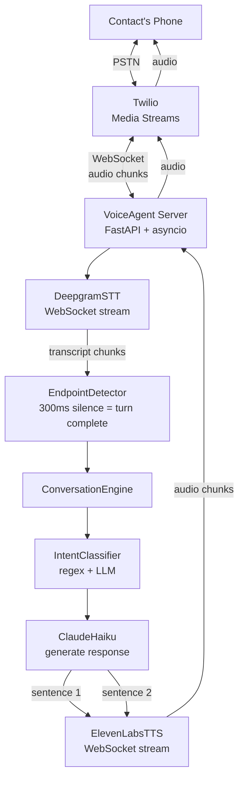
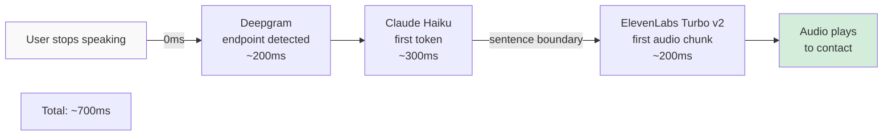
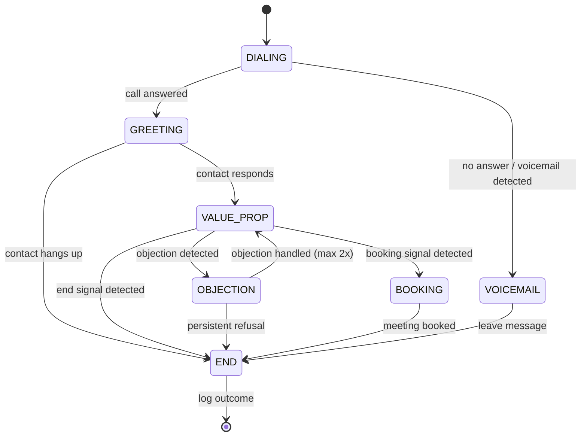
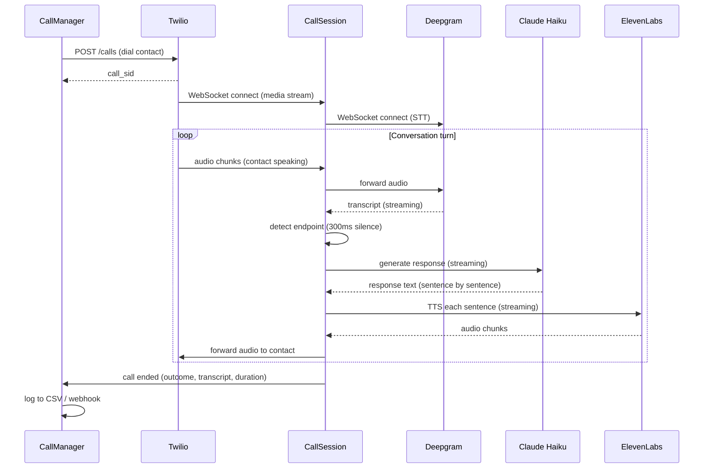

# VoiceAgent
### AI outbound sales agent that makes real phone calls — configure the script in YAML, own your cost.

---

## Why Build This

Voice AI is the fastest-growing segment of applied AI engineering right now. Products from Bland.ai, Retell, and Vapi are generating millions in ARR. They're all doing the same thing: Deepgram → LLM → ElevenLabs → Twilio. This project is that stack, assembled by you.

**What you'll learn:**
- Real-time streaming architecture — how to pipeline audio through 3 APIs with sub-800ms total latency
- WebSocket programming — bidirectional audio streams, backpressure, connection management
- State machine design — conversation flows that handle interruptions, objections, and unexpected input
- Async Python at scale — managing concurrent call sessions with `asyncio`

**Why it stands out on a resume:**
Most AI engineers have never built anything real-time. Text generation is forgiving — a 2-second response is annoying but acceptable. Voice has a hard wall: anything over 800ms sounds broken. Solving that latency problem demonstrates systems thinking that pure ML candidates don't have.

**Standalone value:**
Clone the repo, fill in a `agent.yaml` with your business name and sales script, add API keys, run `docker-compose up`. You have a working AI sales agent. Swap in your own contact list (CSV), hit send. No monthly SaaS contract.

**Cost comparison:**

| Option | Cost per 3-min call |
|---|---|
| Bland.ai / Retell | $0.21 – $0.45 |
| Vapi | $0.18 – $0.40 |
| VoiceAgent (raw APIs) | ~$0.04 – $0.07 |
| Savings | 5–10x cheaper |

---

## Problem

AI voice calling SaaS platforms solve a real need but create two problems:

1. **Cost** — $0.09–$0.15/min adds up fast. A 100-call/day campaign costs $1,620–$2,700/month.
2. **Lock-in** — your call scripts, contact data, and call logs live on their servers. Changing platforms means re-engineering everything.

The technical barrier to building your own isn't the AI — it's the real-time streaming pipeline. Latency compounds across 3 API hops. Most engineers have never dealt with audio streams. This project builds that infrastructure.

---

## What It Does

VoiceAgent dials contacts from a CSV list, conducts a configurable sales conversation, handles objections, attempts to book a meeting, and logs the outcome. The entire script and persona is defined in a YAML config file.

**Configuration example:**

```yaml
# agent.yaml
agent:
  name: Alex
  voice_id: EXAVITQu4vr4xnSDxMaL    # ElevenLabs voice ID
  persona: |
    You are Alex, a friendly sales rep for Acme Corp.
    Keep responses under 2 sentences. Never be pushy.
    If you don't know something, say "I'll have someone follow up."

script:
  greeting: "Hi, is this {contact_name}? This is Alex from Acme Corp — do you have 30 seconds?"
  value_prop: "We help teams like yours cut project delays by 40%. Would you be open to a 15-minute demo this week?"
  
  objections:
    - trigger: "not interested"
      response: "Totally understand — is it timing, or is it not a priority right now?"
    - trigger: "too busy"
      response: "No problem — can I send you a 2-minute video instead?"
    - trigger: "already have something"
      response: "What are you using? Most teams switch after hitting limitations with their current tool."

  booking_signal: "yes|sure|okay|sounds good|let's do it"
  booking_response: "Perfect! I'll send a calendar invite to {contact_email}. Does {suggested_time} work?"
  end_signal: "goodbye|not interested|remove me"

outcomes: [booked_meeting, callback_requested, not_interested, voicemail, no_answer]
```

---

## Architecture

### Real-Time Audio Pipeline



### Latency Budget



**Key insight:** TTS starts on the first sentence while Claude is still generating the rest. The pipeline is streaming throughout — no step waits for the previous one to fully complete.

### Conversation State Machine



### Call Session Lifecycle



---

## Tech Stack

| Library | Version | Role | Why this |
|---|---|---|---|
| `fastapi` + `uvicorn` | 0.100+ | WebSocket server for Twilio Media Streams | Async-native, handles concurrent call sessions cleanly |
| `websockets` | 12.x | Deepgram + ElevenLabs WebSocket clients | Low-level control over audio stream backpressure |
| `anthropic` | latest | Claude Haiku LLM (lowest latency frontier model) | Haiku: ~300ms TTFT vs ~800ms for Sonnet — critical for voice |
| `twilio` | 8.x | Initiate calls, receive Media Streams | Industry standard for telephony |
| `pyyaml` + `pydantic` | latest | Agent config parsing | Sales team can edit YAML without touching code |
| `typer` | 0.x | CLI (`voiceagent dial`, `voiceagent run-list`) | Clean entrypoints |
| `aiofiles` | latest | Async CSV read/write for contact lists and logs | Non-blocking file I/O in async context |
| Docker + Compose | latest | One-command deployment | Reproducible; no environment setup for non-technical users |

**Runtime:** Python 3.11+. Needs outbound internet access for Twilio, Deepgram, ElevenLabs, and Anthropic APIs. Docker recommended.

---

## Standalone Setup

```bash
git clone https://github.com/yourusername/voiceagent
cd voiceagent
cp .env.example .env
# Fill in: TWILIO_ACCOUNT_SID, TWILIO_AUTH_TOKEN, TWILIO_FROM_NUMBER,
#          DEEPGRAM_API_KEY, ELEVENLABS_API_KEY, ANTHROPIC_API_KEY

# Edit agent.yaml with your business name, persona, and sales script

# Start the server
docker-compose up

# Dial a single contact to test
python -m voiceagent.cli dial "+14155551234" --name "John Smith"

# Run a contact list
python -m voiceagent.cli run-list contacts.csv
```

---

## Repo Structure

```
voiceagent/
├── voiceagent/
│   ├── cli.py                 # typer CLI: dial, run-list, test-voice
│   ├── call_manager.py        # ContactLoader, dial queue, orchestration
│   ├── session.py             # CallSession — one per active call
│   ├── engine.py              # ConversationEngine + state machine
│   ├── intent.py              # objection / booking / end signal detection
│   ├── stt/deepgram.py        # WebSocket STT stream
│   ├── tts/elevenlabs.py      # WebSocket TTS + sentence splitter
│   ├── llm/claude.py          # Haiku streaming client
│   ├── telephony/twilio.py    # Media Streams WebSocket handler
│   ├── logger.py              # CSV + webhook outcome logger
│   └── config.py              # agent.yaml → Pydantic models
├── examples/
│   ├── agent.yaml             # sample sales script
│   └── contacts.csv
├── tests/
│   ├── test_engine.py         # state machine unit tests
│   └── test_intent.py         # intent classifier tests
├── PRD.md
├── README.md
├── Dockerfile
├── docker-compose.yml
├── pyproject.toml
└── .env.example
```

---

## Success Criteria

- Latency from end of user speech to start of agent audio < 800ms (measure with `time.perf_counter` in logs)
- Handles 3 sequential objections without breaking conversation flow
- Correctly detects booking signal and logs `booked_meeting` outcome
- Cost per 3-minute call < $0.07 (verify by inspecting API usage logs)
- Non-technical user can configure and run from scratch in under 45 minutes using only the README

---

## Resume Bullets (fill in numbers after building)

- Built a real-time AI voice sales agent achieving < 800ms speech-to-speech latency via sentence-level streaming pipeline across Deepgram STT → Claude Haiku → ElevenLabs TTS
- Engineered interruption handling that cancels in-progress TTS and LLM generation when the contact speaks mid-response, maintaining natural conversation flow
- Reduced cost per call to < $0.07 vs $0.21–$0.45 from SaaS alternatives by assembling the same underlying APIs without a platform markup
- Designed a YAML-configurable conversation state machine with objection handlers, booking detection, and structured outcome logging deployable with `docker-compose up`
