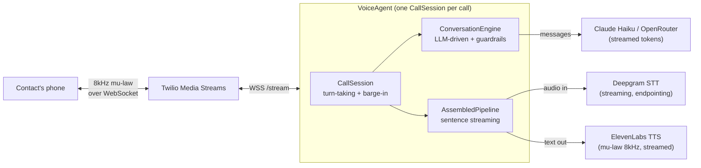

# VoiceAgent

[](https://www.python.org/downloads/)
[](LICENSE)
[](#run-the-tests)
[](#how-it-works)

**Real-time AI outbound sales agent that makes actual phone calls.** Streaming speech-to-text,
an LLM that drives the conversation, and streaming text-to-speech, wired together with barge-in,
compliance gates, and per-call cost metering. The entire persona and script live in one
`agent.yaml`. You own the stack and the cost.

`Tags: voice-ai, real-time, asyncio, twilio, deepgram, elevenlabs, claude, llm, streaming,
websockets, telephony, speech-to-speech, barge-in, python`

VoiceAgent assembles the same stack the commercial voice platforms use (Twilio Media Streams,
Deepgram, an LLM, ElevenLabs) into a headless tool you run yourself, for roughly a fifth of their
per-minute price. It dials a contact, holds a natural sales conversation, answers hard questions
("who is this?", "how did you get my number?"), handles objections, books a meeting, and logs the
outcome.

The hard problem is latency. Text generation is forgiving; a two second reply is fine to read.
Voice is not: past about a second of silence a caller thinks the line dropped. The pipeline
streams end to end, so synthesis of sentence one begins while the model is still writing sentence
two, and a caller talking over the agent cancels the in-flight response instantly.

---

## Status: working, validated on live calls

This is not a mock. Real calls connect to a real phone, hold a real conversation, and book a
meeting end to end. A representative live call (186 seconds) handled "who is this", "I don't know
where you got my number", "a demo for what", "slow down", collected availability and an email,
read it back, and booked, all with the agent driven turn by turn by the LLM.

- **Built and covered by 153 offline tests** (scripted fake providers, zero network): config,
  conversation engine, intent detection, compliance, cost metering, the assembled pipeline, the
  CallSession streaming loop, barge-in, echo suppression, fail-soft, loggers, the campaign runner,
  the Twilio / Deepgram / ElevenLabs / Claude clients, the CLI, and a demo web console.
- **Validated live** on real phone calls; the hard latency and turn-taking bugs that only surface
  on a real call have been found and fixed (see [Architecture decisions](#architecture-decisions)
  and [ISSUES.md](ISSUES.md)).

---

## How it works

### Components



Every external dependency sits behind a Python `Protocol` (`STT`, `TTS`, `LLM`, `Telephony`,
`Pipeline`, `CostMeter`) in `voiceagent/contracts.py`. Deepgram can swap for another STT,
ElevenLabs for another voice, and Claude for any OpenRouter model with a one line config change.
The session loop never changes, and every module is testable against scripted fakes with no
network.

### One turn, end to end

```mermaid
sequenceDiagram
    participant C as Contact
    participant D as Deepgram STT
    participant S as CallSession
    participant L as LLM (Claude)
    participant E as ElevenLabs TTS
    participant T as Twilio

    C->>D: speaks
    D->>S: transcript + endpoint (turn complete)
    Note over S: drop echo of the agent's own audio;<br/>one barge-in per utterance
    S->>L: transcript so far + system prompt
    L-->>S: text tokens (streamed)
    Note over S: aggregate into sentences
    S->>E: sentence 1 (while LLM still writing)
    E-->>S: mu-law audio (streamed)
    S->>T: audio frames
    T->>C: agent speaks
    Note over S,T: if the contact talks over the agent,<br/>cancel LLM + TTS immediately (barge-in)
```

The conversation core is **LLM-driven with deterministic guardrails**. After a fixed opening
(the AI disclosure, played in full for compliance, then an interruptible greeting), the LLM drives
every turn, grounded by a system prompt built from `agent.yaml` (persona, goal, the core pitch,
honest answers about identity and how the number was sourced, and objection hints). Deterministic
code owns only the things that must be reliable:

- **opt-out** ("remove me", "take me off") suppresses the contact and ends the call,
- **explicit goodbye** ends politely,
- **booking** is a two-beat close: confirm and invite a last word, answer any final question, then
  say goodbye, so the agent never hangs up the instant the contact agrees.

Compliance keyword matches inside a question ("if I opt out, will you stop calling?") are treated
as questions and answered honestly, not as commands.

---

## Measured latency (live calls)

Numbers below are from real calls, read from the per-call event timeline
(`call_logs/events/<call_sid>.jsonl`). They are honest, not aspirational.

| Segment | Measured (warm) | Notes |
|---|---|---|
| Greeting first audio after pickup | ~0.2 to 0.4 s | Was ~13 s before the event-loop fix (see ADR-4) |
| Endpoint to LLM first token | ~0.5 to 0.9 s | Claude Haiku streaming |
| LLM first token to TTS first audio | ~0.4 to 0.7 s | ElevenLabs, sentence-level streaming |
| **Endpoint to first agent audio (p50)** | **~0.8 to 1.5 s** | The speech-to-speech number that matters |
| Static guard lines (booking close, etc.) | ~0.13 s | No LLM on the path |
| Audio underrun (buffer starvation) | 0.0 ms | Instrumented; never observed |

The honest floor for a live LLM-driven turn on a three hop chain is around 0.8 to 1.5 seconds
(endpointing plus LLM plus TTS). The original "sub 800 ms" goal is only physical for static
scripted lines, not for a real generated reply. That distinction is documented, not hidden.

---

## Three ways to drive it

1. **YAML is the contract.** `examples/agent.yaml` holds the persona, script, objections, signals,
   pipeline mode, cost caps, and compliance policy. Pydantic validates it at load, before any call
   is dialed. Secrets never go here.
2. **CLI for automation.** `voiceagent dial`, `voiceagent run-list contacts.csv`, and a no-keys
   `voiceagent test-voice` that runs a fully mocked call so you can watch a conversation end to end
   without spending anything.
3. **Demo web console at `/ui`.** Edit and validate the config, pick the pipeline mode, and watch a
   mocked call's transcript, outcome, latency, and cost. Localhost demo tool, no auth.

---

## Quick start (no keys, mocked)

```bash
python3.11 -m venv .venv
. .venv/bin/activate
pip install -e ".[dev]"

# A full mocked conversation in your terminal, zero API keys:
python -m voiceagent.cli test-voice

# Or the demo web console:
python -m voiceagent.cli serve      # then open http://localhost:8080/ui
```

## Run the tests

Deterministic and offline (scripted fake STT / TTS / LLM, no network, no real calls):

```bash
. .venv/bin/activate
python -m pytest -q        # 153 passing
```

## Configuration

Everything is in `examples/agent.yaml`. Copy it, edit the persona and script, point the CLI at it
with `--config`. Highlights:

```yaml
llm:
  provider: claude            # claude | openrouter (any model, model-agnostic)
  model: claude-haiku-4-5     # swap models in one line
  max_tokens: 64              # keeps replies to one or two short spoken sentences
pipeline:
  mode: assembled             # assembled (Deepgram + LLM + ElevenLabs) or realtime (stub)
endpointing_ms: 250           # silence that marks the contact finished a turn
barge_in: true                # let the contact talk over the agent
limits:
  per_call_usd: 0.30          # the call ends gracefully before it overspends
  per_campaign_usd: 25.00
compliance:                   # on by default
  disclose_in_greeting: true
  opt_out_phrases: ["remove me", "do not call", "take me off", "stop calling"]
  calling_hours: { start: "09:00", end: "20:00", timezone: "America/New_York" }
```

## Compliance

Outbound sales calls carry legal weight (TCPA and similar), so compliance is on by default: an AI
disclosure line played in full at the start, opt-out and do-not-call handling (an opt-out utterance
suppresses the contact and is logged, and suppressed numbers are skipped before dialing), optional
recording consent, and timezone-aware calling-hour limits. All secrets stay in `.env`, never in
`agent.yaml` (the config loader enforces this).

---

## Architecture decisions

The interesting engineering here was learned on real calls. Each decision below is recorded in full
in [ISSUES.md](ISSUES.md).

### ADR-1: Assembled pipeline, not a single realtime API

Best-of-breed (Deepgram + Claude + ElevenLabs) behind one `Pipeline` interface, rather than a
single-socket realtime API (OpenAI Realtime, Gemini Live). The realtime APIs are lower latency but
lock you to one vendor and one model, and there is no Claude realtime voice API. The assembled
approach keeps full control of the latency budget and lets any hop be swapped. A `RealtimePipeline`
stub conforms to the same interface if that tradeoff ever changes.

### ADR-2: LLM-driven core, not a scripted state machine

The first version was a rigid script that advanced on turn count. It only survived the happy path;
real callers who asked questions or pushed back broke it. It was rebuilt so the LLM drives every
turn, grounded by the YAML persona and goal, with deterministic code owning only compliance and
booking. That is what lets it answer "how did you get my number?" naturally and still guarantee the
legally required behavior.

### ADR-3: Config as contract

`agent.yaml` is validated by Pydantic before a single call is dialed, and secrets are rejected from
the config file at load. A bad script fails loudly at startup, not mid-call.

### ADR-4: Never block the asyncio event loop (the expensive lesson)

The worst live bug was ten to thirteen seconds of dead air at the start of every call, and the call
going deaf afterward. Root cause: a lazy `import anthropic` firing on the event loop. On the WSL2
`/mnt/c` filesystem that import takes about 14 seconds, and while it blocked the loop the outbound
audio stalled and the Deepgram keepalive stopped, so its socket idle-closed and the agent could no
longer hear the caller. Fix: preload heavy SDKs at server startup and build provider clients via
`asyncio.to_thread`. The event-loop stall dropped from ~14 s to 55 ms. General rule now enforced:
nothing blocking runs on the call path.

### ADR-5: Turn-taking without acoustic echo cancellation

Two real-call bugs came from the phone audio itself. The agent's own speech was transcribed back by
Deepgram and briefly treated as a caller turn (fixed by dropping transcripts that overlap the
agent's in-flight words), and a single caller utterance fired barge-in repeatedly (fixed by
latching barge-in to once per agent turn). Diagnostics (`max_gap_ms`, `max_behind_ms`) proved the
audio streaming itself never underran, so "choppiness" was verbosity and turn timing, not the pipe.

---

## Repo layout

```
voiceagent/
  config.py            agent.yaml to validated Pydantic models
  contracts.py         STT / TTS / LLM / Telephony / Pipeline / CostMeter interfaces
  engine.py            LLM-driven conversation core + deterministic guardrails
  intent.py            opt-out / booking / end detection (regex first, LLM fallback)
  compliance.py        disclosure, opt-out, consent, calling hours
  cost.py              per-call cost meter + campaign budget
  text.py              sentence aggregation for sentence-level streaming
  session.py           CallSession streaming loop, barge-in, echo suppression, LLM pre-warm
  call_manager.py      contact loader + campaign runner
  builder.py           wiring factory (real providers or fakes)
  logger.py            CSV + webhook outcome logging
  cli.py               dial / run-list / test-voice / serve
  server.py            FastAPI Media Streams server
  web/                 demo console mounted at /ui
  stt/ tts/ llm/ telephony/ pipeline/   provider clients behind the interfaces
docs/research/         provider cheat-sheets used while building the clients
tests/                 deterministic, offline, fake-driven (153 tests)
ISSUES.md              the full log of bugs found, fixed, and the decisions behind them
```

## Live test call (gated on your keys)

You need Twilio (account, a Voice-capable number, and on a trial account your own number verified),
Deepgram, ElevenLabs (plus a `voice_id`), and Anthropic keys, and a public HTTPS URL for Twilio
Media Streams (ngrok works). Copy `.env.example` to `.env`, fill in the keys, then:

```bash
# Terminal 1: the server (preloads provider SDKs at boot)
python -m voiceagent.cli serve --port 8080
# Terminal 2: expose it, copy the https URL into PUBLIC_BASE_URL
ngrok http 8080
# Terminal 3: call your own verified phone
PUBLIC_BASE_URL="https://<id>.ngrok-free.app" python -m voiceagent.cli dial "+1YOURNUMBER" --name "You"
```

On a Twilio trial you answer, press 1 at the trial gate, then talk to the agent. The per-call event
timeline lands in `call_logs/events/<call_sid>.jsonl`.

## License

MIT. See [LICENSE](LICENSE).
