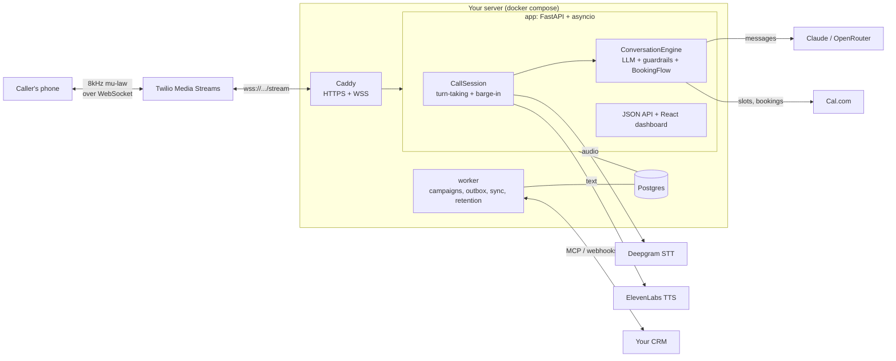

# VoiceAgent

[](https://www.python.org/downloads/)
[](LICENSE)
[](#development)
[](docs/SELF_HOSTING.md)
[](#how-it-works)

**Open-source, self-hosted AI voice agents that answer and place real phone calls and book real
meetings.** Bring your own Twilio, Deepgram, ElevenLabs and LLM keys, connect any CRM through MCP
or webhooks, and run it on a $5 VPS with one `docker compose up`.

`Tags: voice-ai, real-time, asyncio, twilio, deepgram, elevenlabs, claude, mcp, self-hosted,
fastapi, react, telephony, speech-to-speech, barge-in, python`

VoiceAgent assembles the same stack the commercial voice platforms use (Twilio Media Streams,
Deepgram, an LLM, ElevenLabs) into a product you run yourself, paying providers directly at a
fraction of per-minute platform pricing. An agent holds a natural conversation, answers hard
questions ("who is this?", "is this an AI?"), handles objections, reads out real open slots from
your Cal.com calendar, books one while the caller is on the line, and reports the outcome to your
CRM.

The hard problem is latency. Past about a second of silence a caller thinks the line dropped. The
pipeline streams end to end, so synthesis of sentence one starts while the model is still writing
sentence two, and a caller talking over the agent cancels the in-flight reply instantly.

---

## Features

- **Inbound and outbound agents.** A receptionist that answers your Twilio number, or a campaign
  that calls consented leads. One validated config per agent: persona, script, booking, compliance.
- **Real booking during the call.** The agent offers two real open slots ("tomorrow at 10 or
  Wednesday at 3:30?"), understands the reply ("the first one", "Tuesday at 10"), captures and
  reads back an email if needed, books on Cal.com, and confirms the actual time.
- **Any CRM.** A generic MCP client (pick the lead tool and the outcome tool, map fields), a
  signed-webhook pair, or CSV. Outcomes are delivered through an outbox with retries, so a CRM
  outage never loses a result. See [docs/CONNECTORS.md](docs/CONNECTORS.md).
- **Compliance built in, not optional.** Outbound calls need recorded consent. A per-workspace
  do-not-call list fills itself when someone says "remove me". Calling hours use the callee's local
  time inside 8am to 9pm. The AI disclosure is always spoken first.
- **Multi-tenant.** Workspaces with their own encrypted provider keys, agents, numbers, leads and
  call history, isolated from each other. A dashboard for everything.
- **Self-hosted.** Docker Compose with Caddy (automatic HTTPS and `wss://`), Postgres and a
  background worker. Your data and keys stay on your server.
- **Answering machines.** Twilio async AMD leaves a short voicemail or hangs up, without delaying
  the greeting for a human.
- **Honest measurements.** Per-call cost metering with hard caps, per-turn latency, and a full event
  timeline for every call.

## Self-host in five minutes

On a server with Docker and a domain pointing at it:

```bash
git clone https://github.com/HamzaElSousi/voiceagent.git && cd voiceagent
cp .env.example .env
docker compose run --rm --no-deps app init-instance --print --domain voice.example.com >> .env
docker compose up -d
```

Open `https://voice.example.com`, create the admin account, and follow the setup checklist: add
your provider keys, create an agent from a template, and press **Call me now** to hear it on your
phone. The full guide (backups, upgrades, troubleshooting) is in
[docs/SELF_HOSTING.md](docs/SELF_HOSTING.md).

---

## How it works

### Components



Every external dependency sits behind a Python `Protocol` (`STT`, `TTS`, `LLM`, `Telephony`,
`Booker`, `CostMeter`) in `voiceagent/contracts.py`. Any hop can be swapped, and every module is
tested against scripted fakes with no network.

### One turn, end to end

```mermaid
sequenceDiagram
    participant C as Caller
    participant T as Twilio
    participant S as CallSession
    participant D as Deepgram STT
    participant L as LLM (Claude)
    participant E as ElevenLabs TTS

    C->>T: speaks
    T->>S: inbound mu-law frames (Media Stream)
    S->>D: forward audio
    D->>S: transcript + endpoint (turn complete)
    Note over S: drop echo of the agent's own audio;<br/>one barge-in per utterance
    S->>L: transcript so far + system prompt
    L-->>S: text tokens (streamed)
    Note over S: aggregate into sentences
    S->>E: sentence 1 (while LLM still writing)
    E-->>S: mu-law audio (streamed)
    S->>T: audio frames
    T->>C: agent speaks
    Note over C,S: if the caller talks over the agent,<br/>cancel LLM + TTS immediately (barge-in)
```

The conversation core is **LLM-driven with deterministic guardrails**. After a fixed opening (the
AI disclosure, played in full, then an interruptible greeting), the LLM drives every turn, grounded
by a system prompt built from the agent config. Deterministic code owns only what must be reliable:

- **opt-out** ("remove me", "take me off") adds the number to the do-not-call list and ends the call;
- **explicit goodbye** ends politely;
- **booking**: agreement hands the turn to `BookingFlow`, which offers real slots, books one, and
  confirms the time, then a two-beat close (invite a last word, answer it, then goodbye).

Compliance phrases inside a question ("if I opt out, will you stop calling?") are answered
honestly, not treated as commands.

---

## Measured latency (live calls)

From real calls, read from the per-call event timeline (`call_logs/events/<call_sid>.jsonl`).

| Segment | Measured (warm) | Notes |
|---|---|---|
| Greeting first audio after pickup | ~0.2 to 0.4 s | Was ~13 s before the event-loop fix (ADR-4) |
| Endpoint to LLM first token | ~0.5 to 0.9 s | Claude Haiku streaming |
| LLM first token to TTS first audio | ~0.4 to 0.7 s | ElevenLabs, sentence-level streaming |
| **Endpoint to first agent audio (p50)** | **~0.8 to 1.5 s** | The speech-to-speech number that matters |
| Static guard lines (booking close, etc.) | ~0.13 s | No LLM on the path |
| Audio underrun (buffer starvation) | 0.0 ms | Instrumented; never observed |

The honest floor for a live LLM-driven turn on a three-hop chain is about 0.8 to 1.5 seconds.
Sub-500 ms is only physical for static lines, not for a generated reply.

---

## Configuration

Each agent is one validated config, edited in the dashboard (or as YAML in CLI dev mode, see
`examples/agent.yaml` and `examples/inbound.yaml`):

```yaml
mode: outbound                # outbound | inbound
llm:
  provider: claude            # claude | openrouter (any model)
  model: claude-haiku-4-5
  max_tokens: 64              # one or two short spoken sentences
script:
  greeting: "Hi, is this {contact_name}? This is Alex from Acme. Do you have 30 seconds?"
  value_prop: "We help teams cut project delays by 40%."
  meeting: "a 15-minute demo"
booking:
  provider: calcom            # none (log the agreement) | calcom (book real slots live)
  username: acme
  event_type_slug: 15min
  offer_count: 2
voicemail:
  detect: true
  action: leave_message       # leave_message | hang_up
limits:
  per_call_usd: 0.30          # the call ends gracefully before it overspends
compliance:
  ai_disclosure: "Before we start, I'm an AI assistant calling on behalf of Acme."
  calling_hours: { start: "09:00", end: "20:00", timezone: "America/New_York" }
```

Secrets never go in a config: the loader rejects them. Provider keys live encrypted in the
database (platform) or in `.env` (CLI dev mode).

## Compliance

AI-voice calls count as "artificial voice" under the US TCPA (FCC ruling, February 2024), and
Canada's CRTC restricts automated solicitation calls. VoiceAgent enforces, for every workspace:

- outbound dialing only to leads with a recorded consent date (scraped or listed numbers are not
  consent; collect it first, for example with a "request a call" link);
- a do-not-call list checked before every dial, filled automatically on spoken opt-outs;
- calling hours in the callee's local time, always inside 8am to 9pm, conservative when a number
  could be in several zones;
- the AI disclosure, played in full and non-interruptible, at the start of every call.

This is not legal advice. Each workspace accepts responsibility for its calls at sign-up.

---

## Architecture decisions

The interesting engineering was learned on real calls. The full log is in [ISSUES.md](ISSUES.md).

### ADR-1: Assembled pipeline, not a single realtime API

Best-of-breed (Deepgram + Claude + ElevenLabs) behind one `Pipeline` interface rather than a
single-socket realtime API. Realtime APIs are lower latency but lock you to one vendor and model,
and there is no Claude realtime voice API. The assembled approach keeps full control of the latency
budget and lets any hop be swapped.

### ADR-2: LLM-driven core, not a scripted state machine

The first version was a rigid script that only survived the happy path. It was rebuilt so the LLM
drives every turn, grounded by the persona and goal, with deterministic code owning compliance and
booking. That is what lets it answer "is this an AI?" naturally and still guarantee the legally
required behavior.

### ADR-3: Config as contract

Agent configs are validated by Pydantic before a single call is dialed, from YAML, the database or
the API alike, and secrets are rejected at load. A bad script fails loudly at save time, not
mid-call.

### ADR-4: Never block the asyncio event loop (the expensive lesson)

The worst live bug was ten to thirteen seconds of dead air at the start of every call, and the call
going deaf afterward. Root cause: a lazy `import anthropic` on the event loop (14 s on WSL2's
`/mnt/c`), which stalled outbound audio and the Deepgram keepalive. Fix: preload heavy SDKs at
startup, build clients via `asyncio.to_thread`. The rule now covers the whole platform: password
hashing, phone-number metadata, Twilio's sync SDK and DNS lookups all run off the loop, because the
API shares the loop with live calls.

### ADR-5: Turn-taking without acoustic echo cancellation

The agent's own speech was transcribed back and briefly treated as a caller turn (fixed by dropping
transcripts that overlap the agent's in-flight words), and one utterance fired barge-in repeatedly
(fixed by latching barge-in once per agent turn).

### ADR-6: Booking is shielded from barge-in

Slots are prefetched as a background task at call start, so offering them costs nothing on the
turn. The booking request runs as its own task, shielded from cancellation: if the caller talks over
"let me lock that in", the booking still completes and is recorded.

### ADR-7: Claim, then dial

The campaign scheduler commits a lead's attempt and a call row before asking Twilio to dial, so a
crash or restart can never call the same person twice. Concurrency is counted in Postgres, so the
limit holds across the web and worker processes.

### ADR-8: Vendor-neutral CRM integration through MCP

Instead of shipping one integration per CRM, VoiceAgent speaks MCP: any CRM that exposes an MCP
server works by picking two tools and mapping fields, with the dashboard's connection test listing
the server's tools and previewing mapped leads. Webhooks cover everything else.

---

## Development

```bash
python3.11 -m venv .venv && . .venv/bin/activate
pip install -e ".[dev]"

python -m voiceagent.cli test-voice --book   # a full mocked call with booking, zero keys
python -m pytest -q                          # 317 tests, deterministic, zero network

python -m voiceagent.cli serve --port 8080   # API + dashboard (SQLite in dev)
cd web && npm install && npm run dev         # dashboard with hot reload on :5173
```

**CLI dev mode** still drives a single agent from `examples/agent.yaml` with keys in `.env`, no
database: `voiceagent dial "+1..." --name "You"` places one live call (expose the server with ngrok
and set `PUBLIC_BASE_URL`). See [CONTRIBUTING.md](CONTRIBUTING.md) for the ground rules.

## Repo layout

```
voiceagent/
  contracts.py         STT / TTS / LLM / Telephony / Booker / CostMeter interfaces
  config.py            agent config: validated Pydantic models
  session.py           CallSession streaming loop, barge-in, echo suppression, AMD
  engine.py            LLM-driven conversation core + deterministic guardrails
  booking/             BookingFlow (slots, choice, email capture), Cal.com client
  connectors/          generic MCP client, webhooks, CSV, field mapping, SSRF guard
  phones.py            E.164 normalization, callee timezones
  app/                 the platform: models, auth, encrypted keys, API, campaigns,
                       eligibility, outbox, Twilio voice routes, worker, migrations
  server.py            FastAPI: media streams, API, dashboard, voice webhooks
  cli.py               serve / worker / init-instance / create-admin / test-voice / dial
  stt/ tts/ llm/ telephony/ pipeline/   provider clients behind the interfaces
web/                   React dashboard (Vite + TypeScript + Tailwind)
docs/                  SELF_HOSTING.md, CONNECTORS.md, provider research notes
tests/                 deterministic, offline, fake-driven
docker-compose.yml     caddy + app + worker + postgres
```

## License

MIT. See [LICENSE](LICENSE).
